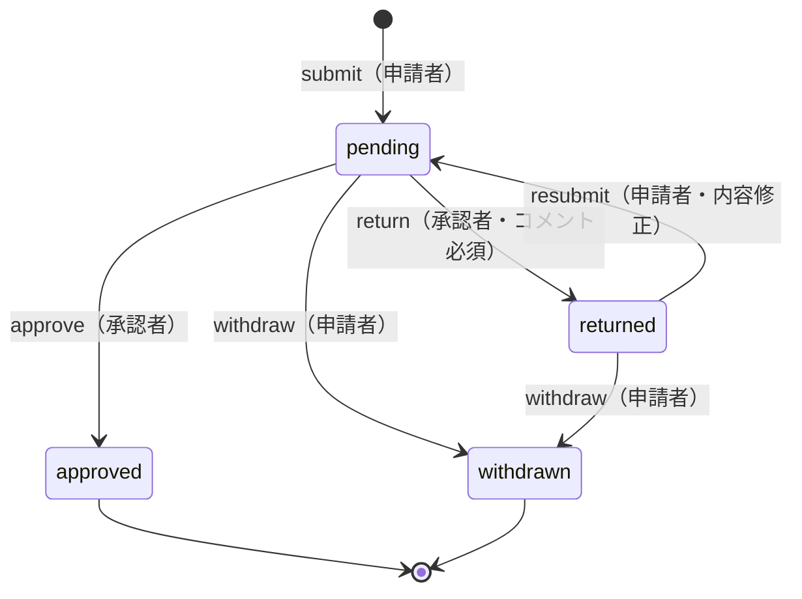

# 状態遷移 — Đơn nghỉ phép (leave_requests.status)

Căn cứ: 質問票 No.8, 9, 10, 13 (`docs/qa/sprint1-qa.md`).

| Trạng thái (giá trị DB) | 日本語 | Ý nghĩa |
|---|---|---|
| `pending` | 申請中 | Đang chờ cấp trên xử lý |
| `approved` | 承認済 | Đã duyệt (kết thúc; hủy đơn đã duyệt → Sprint 2 xem xét) |
| `returned` | 差戻し | Bị trả lại, người nộp sửa và nộp lại |
| `withdrawn` | 取下げ | Người nộp rút đơn (kết thúc) |

## Bảng chuyển trạng thái

| Hành động (`approval_histories.action`) | Từ | Sang | Ai được làm | Ghi chú |
|---|---|---|---|---|
| `submit` | (mới) | `pending` | Người nộp | Approver = cấp trên trực tiếp lúc nộp; user không có cấp trên → không nộp được |
| `approve` | `pending` | `approved` | Approver của đơn | Comment không bắt buộc; không tự duyệt đơn của mình |
| `return` | `pending` | `returned` | Approver của đơn | **Comment bắt buộc** |
| `resubmit` | `returned` | `pending` | Người nộp | Sửa nội dung rồi nộp lại cùng đơn |
| `withdraw` | `pending`, `returned` | `withdrawn` | Người nộp | |

- Mọi hành động đều ghi 1 dòng `approval_histories` (ai, lúc nào, hành động, comment) — 質問票 No.14.
- Chuyển trạng thái không hợp lệ (ví dụ approve đơn `approved`) → **409 Conflict** (D-037).
